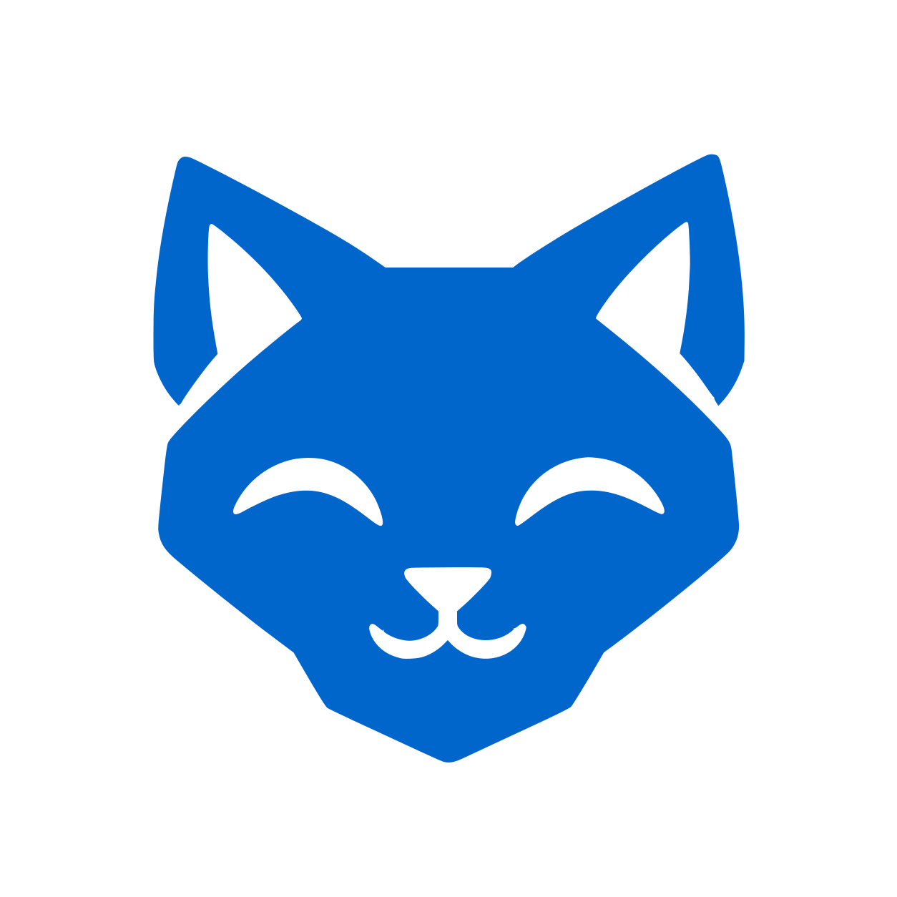
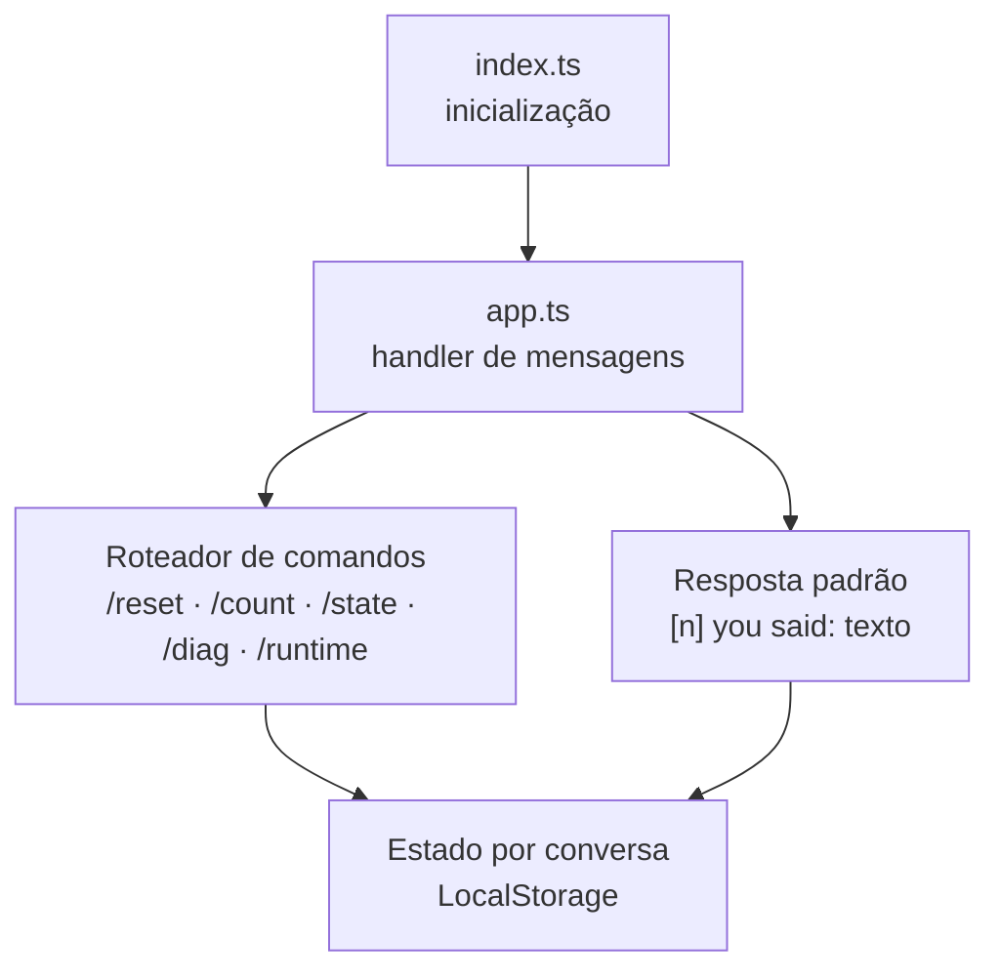
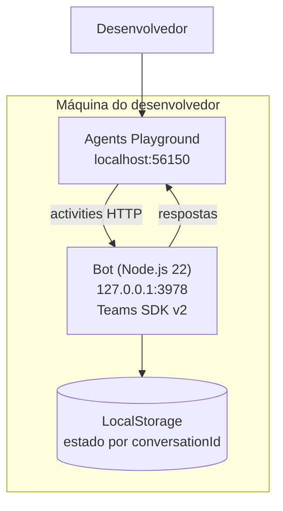
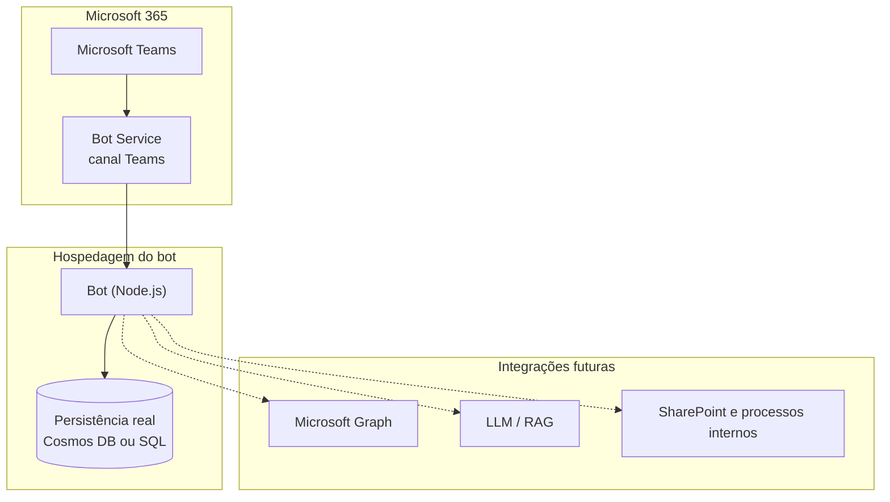
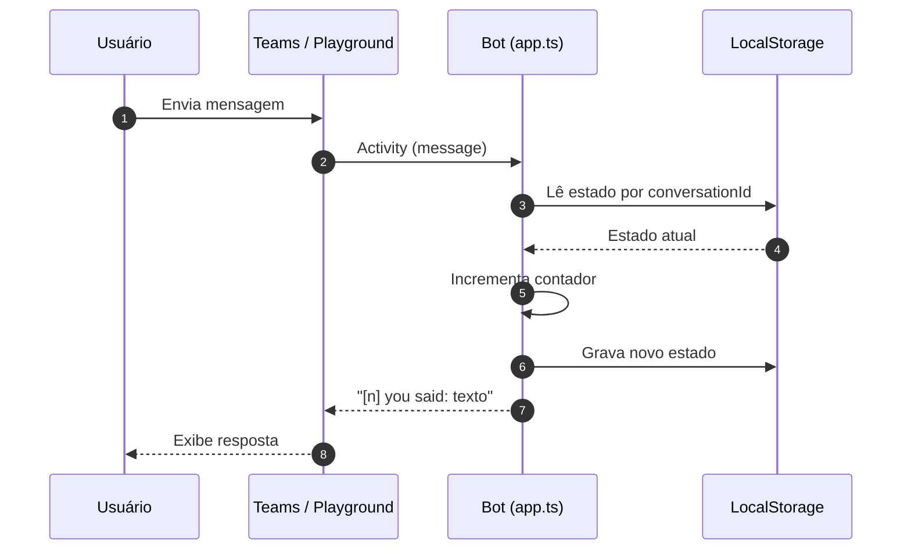
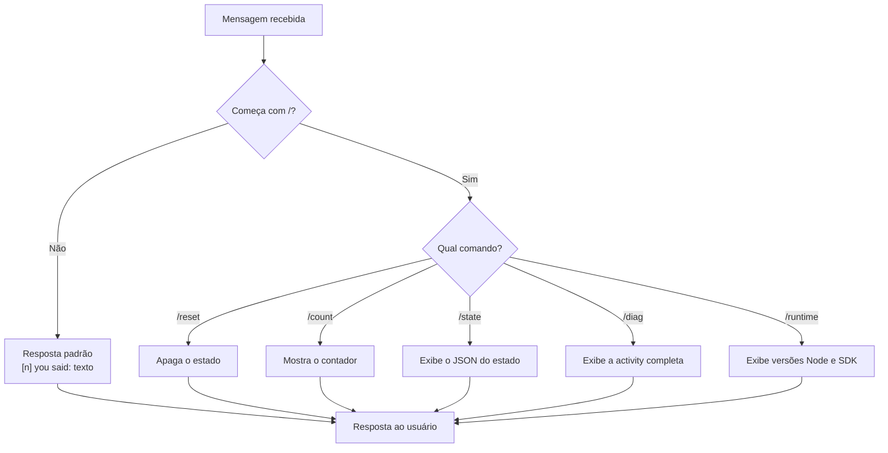
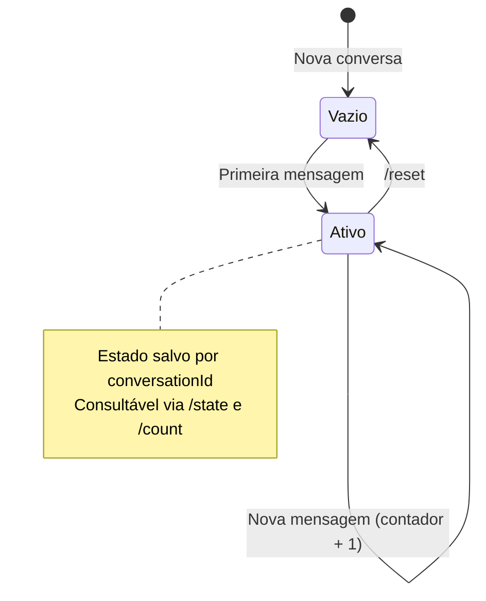

<div align="center">



# Assistente de Equipe

> Bot para **Microsoft Teams** com estado por conversa, comandos de diagnóstico e base preparada para IA, automações e integração com dados da organização.
> Construído com **Microsoft 365 Agents Toolkit** e **Teams SDK v2**.


</div>

<!-- VALIDAR: conferir a versão do Teams SDK v2 e do TypeScript no package.json. -->

---

## Índice

- [Assistente de Equipe](#assistente-de-equipe)
  - [Índice](#índice)
  - [1. Visão geral](#1-visão-geral)
    - [Objetivo de negócio](#objetivo-de-negócio)
    - [Problemas que resolve](#problemas-que-resolve)
    - [Personas](#personas)
  - [2. Principais funcionalidades](#2-principais-funcionalidades)
    - [Conversação](#conversação)
    - [Comandos de diagnóstico](#comandos-de-diagnóstico)
    - [Desenvolvimento](#desenvolvimento)
  - [3. Arquitetura da solução](#3-arquitetura-da-solução)
    - [Responsabilidades internas](#responsabilidades-internas)
  - [4. Diagrama de arquitetura](#4-diagrama-de-arquitetura)
    - [4.1 Visão de contêineres (desenvolvimento local)](#41-visão-de-contêineres-desenvolvimento-local)
    - [4.2 Visão em produção (alvo)](#42-visão-em-produção-alvo)
    - [4.3 Como cada componente se comunica](#43-como-cada-componente-se-comunica)
  - [5. Estrutura de pastas](#5-estrutura-de-pastas)
    - [Raiz do projeto](#raiz-do-projeto)
    - [Responsabilidade de cada arquivo](#responsabilidade-de-cada-arquivo)
  - [6. Tecnologias utilizadas](#6-tecnologias-utilizadas)
    - [Aplicação](#aplicação)
    - [Ferramentas de desenvolvimento](#ferramentas-de-desenvolvimento)
    - [Evolução prevista](#evolução-prevista)
  - [7. Padrões arquiteturais adotados](#7-padrões-arquiteturais-adotados)
  - [8. Fluxo de mensagens](#8-fluxo-de-mensagens)
    - [8.1 Mensagem comum](#81-mensagem-comum)
    - [8.2 Comando](#82-comando)
  - [9. Gerenciamento de estado](#9-gerenciamento-de-estado)
    - [Hierarquia de estado](#hierarquia-de-estado)
    - [Ciclo de vida do estado](#ciclo-de-vida-do-estado)
  - [10. Comandos disponíveis](#10-comandos-disponíveis)
  - [11. Configurando o ambiente](#11-configurando-o-ambiente)
    - [Pré-requisitos](#pré-requisitos)
    - [Passo a passo](#passo-a-passo)
    - [Portas](#portas)
  - [12. Executando o projeto](#12-executando-o-projeto)
    - [Opção A: Playground pela linha de comando](#opção-a-playground-pela-linha-de-comando)
    - [Opção B: Debug no VS Code (recomendado)](#opção-b-debug-no-vs-code-recomendado)
  - [13. Publicação e distribuição](#13-publicação-e-distribuição)
    - [Riscos e dívidas técnicas](#riscos-e-dívidas-técnicas)
  - [14. Convenções do projeto](#14-convenções-do-projeto)
    - [Gerais](#gerais)
    - [Código (TypeScript)](#código-typescript)
  - [15. Roadmap](#15-roadmap)
  - [Objetivo](#objetivo)

---

## 1. Visão geral

### Objetivo de negócio

O Assistente de Equipe é uma base limpa para um **assistente de trabalho dentro do Microsoft Teams**. Hoje ele funciona como um *echo* com memória por conversa; o objetivo é evoluir gradualmente para automações, notificações e integração com dados da organização.

### Problemas que resolve

| Problema | Como o projeto ajuda |
| -------- | -------------------- |
| Começar um bot do Teams do zero consome tempo | Template pronto, com scaffold, tunneling e debug via Agents Toolkit |
| Testar bots exige registro de app e conta de desenvolvedor | Testes locais pelo Agents Playground, sem Azure AD |
| Difícil inspecionar o que o Teams envia ao bot | Comandos `/diag`, `/state` e `/runtime` expõem activity, estado e versões |
| Perda de contexto entre mensagens | Estado persistido por `conversationId` |
| Evoluir de echo para assistente real sem refazer a base | Estrutura enxuta, com pontos de extensão claros em `app.ts` |

### Personas

| Persona | O que faz |
| ------- | --------- |
| Desenvolvedor | Evolui o bot, adiciona intenções, cards e integrações |
| Membro da equipe | Conversa com o bot no Teams e usa os comandos |
| Administrador do tenant | Publica e governa o app no Teams |

---

## 2. Principais funcionalidades

### Conversação
- Resposta a qualquer mensagem no formato `[n] you said: <texto>`, em que `n` é o contador da conversa
- Estado isolado por conversa (`conversationId`)

### Comandos de diagnóstico
- `/reset`: apaga o estado da conversa
- `/count`: mostra quantas mensagens foram enviadas
- `/state`: exibe o JSON do estado salvo
- `/diag`: exibe a activity completa recebida
- `/runtime`: exibe versões do Node e do SDK

### Desenvolvimento
- Execução local pelo Microsoft 365 Agents Playground
- Debug com F5 no VS Code
- Configuração por ambiente (`env/`) e pelo Toolkit (`m365agents*.yml`)

---

## 3. Arquitetura da solução

O repositório é uma **aplicação única** (Node.js + TypeScript) criada a partir do template Basic Bot do Agents Toolkit.

| Componente | Stack | Papel |
| ---------- | ----- | ----- |
| `index.ts` | Node.js 22 + Teams SDK v2 | Inicialização do app e do servidor HTTP do bot |
| `app.ts` | TypeScript | Handler de mensagens, roteamento de comandos e estado |
| `appPackage/` | JSON + ícones | Manifesto do app Teams (nome, descrição, metadados) |
| `m365agents*.yml` | YAML | Ciclo de vida do Toolkit: provisionar, executar, publicar |
| `env/` | dotenv | Variáveis por ambiente |

### Responsabilidades internas



---

## 4. Diagrama de arquitetura

### 4.1 Visão de contêineres (desenvolvimento local)



### 4.2 Visão em produção (alvo)



> As integrações tracejadas fazem parte do [roadmap](#15-roadmap) e ainda não estão implementadas.

### 4.3 Como cada componente se comunica

| Origem | Destino | Protocolo / mecanismo | Autenticação |
| ------ | ------- | --------------------- | ------------ |
| Playground | Bot | HTTP local (`:3978`) | Nenhuma (apenas desenvolvimento) |
| Teams | Bot Service | Canal Teams | Gerenciada pela Microsoft |
| Bot Service | Bot | HTTPS (mensagens) | Credenciais do app registrado |
| Bot | Estado | `LocalStorage` (atual) | N/A |

<!-- VALIDAR: confirmar o modelo de autenticação do Bot Service conforme o registro do app em produção. -->

---

## 5. Estrutura de pastas

### Raiz do projeto

```text
.
├── app.ts                    # Lógica do bot: handler de mensagens e estado
├── index.ts                  # Inicialização do app
├── appPackage/
│   └── manifest.json         # Nome, descrição e metadados do app Teams
├── m365agents.yml            # Configuração do Toolkit (ambientes remotos)
├── m365agents.playground.yml # Configuração do Toolkit (Playground local)
├── env/                      # Variáveis por ambiente
└── img/
    └── logo.png              # Logo do projeto
```

### Responsabilidade de cada arquivo

| Caminho | Responsabilidade |
| ------- | ---------------- |
| `app.ts` | Registra handlers, trata comandos, responde mensagens e lê/grava estado |
| `index.ts` | Cria e inicia o app do Teams SDK |
| `appPackage/manifest.json` | Define como o app aparece e se comporta no Teams (nome, descrição, comandos) |
| `m365agents.yml` | Pipeline de provisionamento, deploy e publicação |
| `m365agents.playground.yml` | Pipeline usado pelo Agents Playground |
| `env/` | Variáveis por ambiente (local, dev, prod); sem segredos no repositório |

---

## 6. Tecnologias utilizadas

### Aplicação

| Tecnologia | Versão | Para que serve |
| ---------- | ------ | -------------- |
| Node.js | 22 | Runtime |
| TypeScript | (ver `package.json`) | Tipagem estática |
| Teams SDK | v2 | Framework do bot (activities, handlers, servidor) |

### Ferramentas de desenvolvimento

| Ferramenta | Para que serve | Por que usar |
| ---------- | -------------- | ------------ |
| Microsoft 365 Agents Toolkit (extensão do VS Code ou CLI) | Scaffold, deploy, tunneling e debug | Padroniza criação e publicação de bots Teams, com suporte oficial |
| Agents Playground / Teams App Test Tool | Testar o bot localmente | Dispensa registro no Azure AD e conta de desenvolvedor; acelera a iteração |
| Debug local (Bot Framework SDK legado) | Cenários legados | Permite diagnóstico profundo quando necessário |

### Evolução prevista

| Tecnologia | Para que serve | Por que usar |
| ---------- | -------------- | ------------ |
| Copilot Studio | Alternativa low-code com IA | Prototipa fluxos rapidamente e pode ser combinado com código |
| Bot Framework Connector / LLM | IA no bot (RAG, tool calling, multiagente) | Habilita linguagem natural e orquestração com agentes |
| Orquestração de agentes | Modelo, RAG e guardrails | Dá governança, segurança e consistência às respostas |
| Automação de backend | Disparar bot, enviar cards, integrar com SharePoint | Conecta o bot a processos e dados internos |
| Cosmos DB / SQL | Persistência de estado | Substitui o `LocalStorage` em ambientes reais |

---

## 7. Padrões arquiteturais adotados

| Padrão | Onde está | Como é aplicado |
| ------ | --------- | --------------- |
| **Handler de mensagens** | `app.ts` | Um ponto de entrada para toda activity de mensagem recebida |
| **Roteamento por comando** | `app.ts` | Mensagens iniciadas por `/` são tratadas antes da resposta padrão |
| **Estado por conversa** | `LocalStorage` | Chave baseada em `conversationId`, isolando cada conversa |
| **Configuração por ambiente** | `env/` + `m365agents*.yml` | Mesmo código, diferentes ambientes (local, dev, prod) |
| **Manifest como contrato** | `appPackage/manifest.json` | Declara identidade e comandos do app no Teams |
| **Evolução incremental** | Roadmap | Echo primeiro, intenções e IA depois, sem reescrever a base |

---

## 8. Fluxo de mensagens

### 8.1 Mensagem comum



### 8.2 Comando



<!-- VALIDAR: conferir em app.ts como comandos desconhecidos são tratados (hoje assumido: caem na resposta padrão). -->

---

## 9. Gerenciamento de estado

### Hierarquia de estado

| Camada | Onde vive | Responsabilidade |
| ------ | --------- | ---------------- |
| **Estado da conversa** | `LocalStorage` | Contador de mensagens e dados por `conversationId` |
| **Configuração** | `env/` | Parâmetros por ambiente |
| **Contexto da activity** | Memória (por requisição) | Dados da mensagem atual enviados pelo Teams |

### Ciclo de vida do estado



> O `LocalStorage` é adequado para desenvolvimento. Em produção, o estado deve migrar para persistência real (Cosmos DB ou SQL), conforme o [roadmap](#15-roadmap).

---

## 10. Comandos disponíveis

| Comando | O que faz | Uso típico |
| ------- | --------- | ---------- |
| (mensagem comum) | Responde `[n] you said: <texto>` | Validar o fluxo ponta a ponta |
| `/reset` | Apaga o estado da conversa | Recomeçar um teste |
| `/count` | Mostra quantas mensagens você enviou | Conferir o contador |
| `/state` | Exibe o JSON do estado salvo | Depurar o estado |
| `/diag` | Exibe a activity completa | Inspecionar o payload do Teams |
| `/runtime` | Exibe versão do Node e do SDK | Confirmar o ambiente de execução |

---

## 11. Configurando o ambiente

### Pré-requisitos

| Ferramenta | Versão | Necessário para |
| ---------- | ------ | --------------- |
| Node.js | 22 | Execução do bot |
| Microsoft 365 Agents Toolkit | extensão do VS Code ≥ 5.0, ou CLI | Scaffold, debug e publicação |
| VS Code | recente | Debug com F5 (opcional se usar a CLI) |

### Passo a passo

**1. Clonar**

```bash
git clone <url-do-repositorio> && cd <nome-do-projeto>
```

**2. Instalar dependências**

```bash
npm install
```

**3. Configurar variáveis**

Revise os arquivos em `env/`. Para o Playground local, nenhuma credencial é necessária.

### Portas

| Serviço | Endereço |
| ------- | -------- |
| Agents Playground | `http://localhost:56150` |
| Bot (endpoint de mensagens) | `http://127.0.0.1:3978` |

<!-- VALIDAR: listar as variáveis reais de env/ (ex.: BOT_ID, BOT_PASSWORD) quando o app for registrado. -->

---

## 12. Executando o projeto

### Opção A: Playground pela linha de comando

```bash
npm run dev:teamsfx:playground
```

### Opção B: Debug no VS Code (recomendado)

Pressione **F5** e selecione **Debug in Microsoft 365 Agents Playground**.

Depois, acesse `http://localhost:56150` e converse com o bot. Use `/runtime` para confirmar o ambiente e `/diag` para inspecionar a activity.

---

## 13. Publicação e distribuição

A publicação é feita pelo **Microsoft 365 Agents Toolkit**, usando os arquivos `m365agents.yml` e `appPackage/manifest.json`.

| Etapa | Descrição | Status |
| ----- | --------- | ------ |
| Desenvolvimento local | Playground e debug no VS Code | Disponível |
| Provisionamento | Registro do app e recursos no tenant | Pendente |
| Publicação no Teams | Distribuição para a organização via Toolkit | Pendente |

### Riscos e dívidas técnicas

| Dívida / risco | Situação | Encaminhamento |
| -------------- | -------- | -------------- |
| Estado em `LocalStorage` | Volátil e sem escala | Migrar para Cosmos DB ou SQL |
| Resposta ainda é um echo | Sem intenções reais | Implementar intenções em `app.ts` |
| Sem autenticação para dados da organização | Necessária para o Graph | Integrar Microsoft Graph com autenticação |
| Comandos não declarados no manifest | Menos descobríveis no Teams | Declarar comandos no `manifest.json` |

---

## 14. Convenções do projeto

### Gerais

| Tema | Convenção |
| ---- | --------- |
| Idioma | Documentação em **pt-BR**; código em **inglês** |
| Commits | Conventional Commits: `feat:`, `fix:`, `refactor:`, `docs:` |
| Segredos | **Nunca** no repositório. Usar variáveis em `env/` não versionadas |

### Código (TypeScript)

| Tema | Convenção |
| ---- | --------- |
| Tipagem | Evitar `any`; preferir tipos explícitos |
| Handlers | Um tratamento por comando, com resposta clara ao usuário |
| Estado | Sempre indexado por `conversationId` |
| Novos comandos | Documentar na seção [10](#10-comandos-disponíveis) e, quando aplicável, no manifest |

---

## 15. Roadmap

| Fase | Escopo | Status |
| ---- | ------ | ------ |
| F1 | Base Basic Bot com estado por conversa e comandos de diagnóstico | Concluída |
| F2 | Intenções reais em `app.ts`, Adaptive Cards e comandos no manifest | Pendente |
| F3 | Integração com Microsoft Graph e autenticação | Pendente |
| F4 | Persistência real (Cosmos DB ou SQL) | Pendente |
| F5 | LLM com RAG, tool calling e guardrails | Pendente |
| F6 | Publicação no Teams via Toolkit | Pendente |

---

## Objetivo

Oferecer uma base limpa para um assistente de trabalho, com evolução gradual rumo a **automações**, **notificações** e **integração com os dados da organização**.